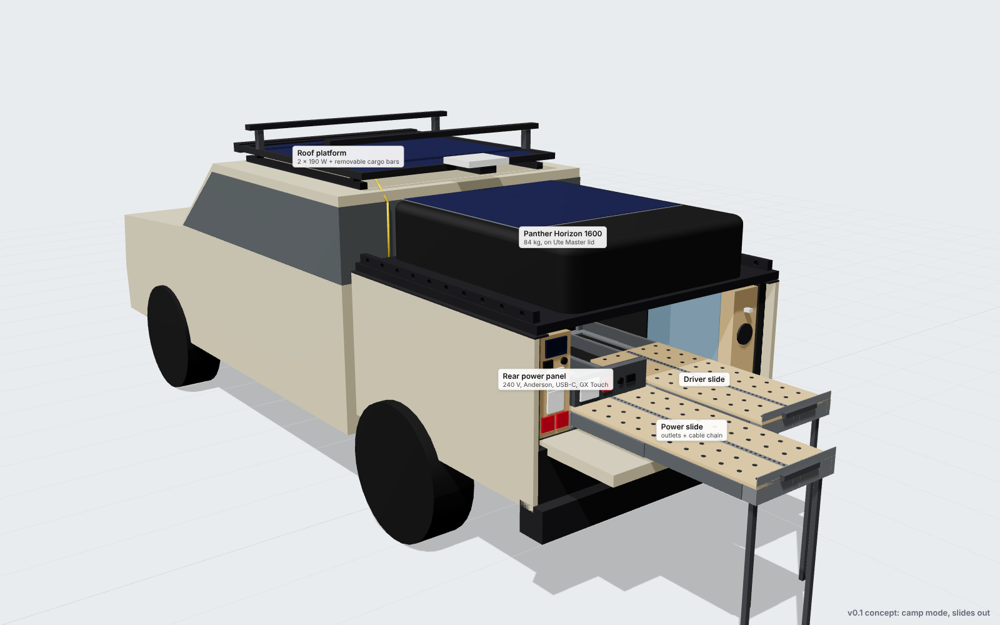
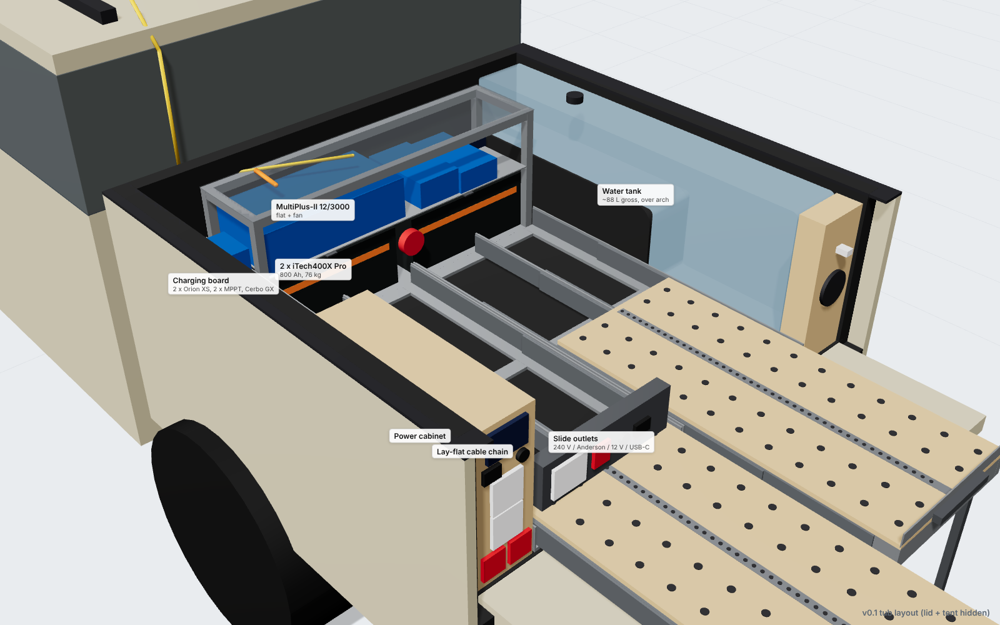
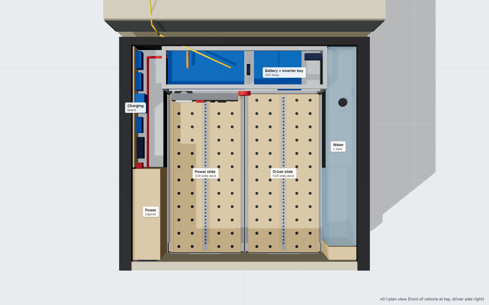
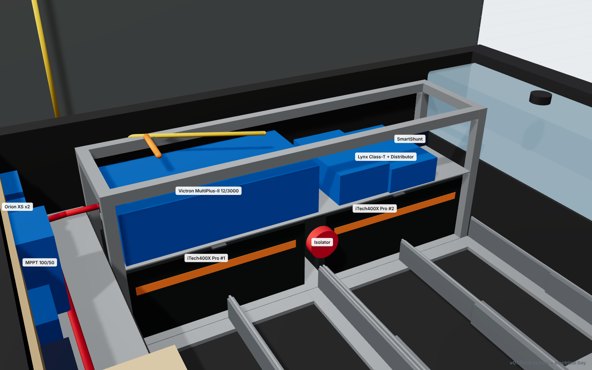
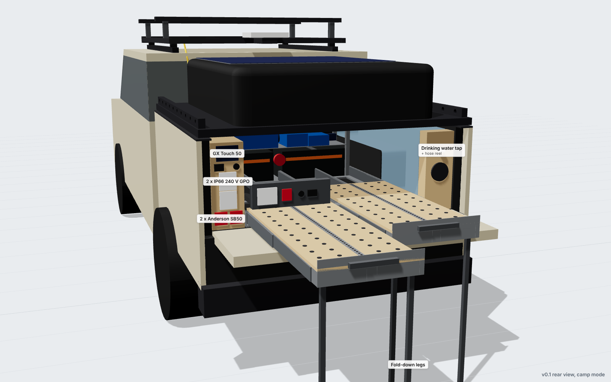
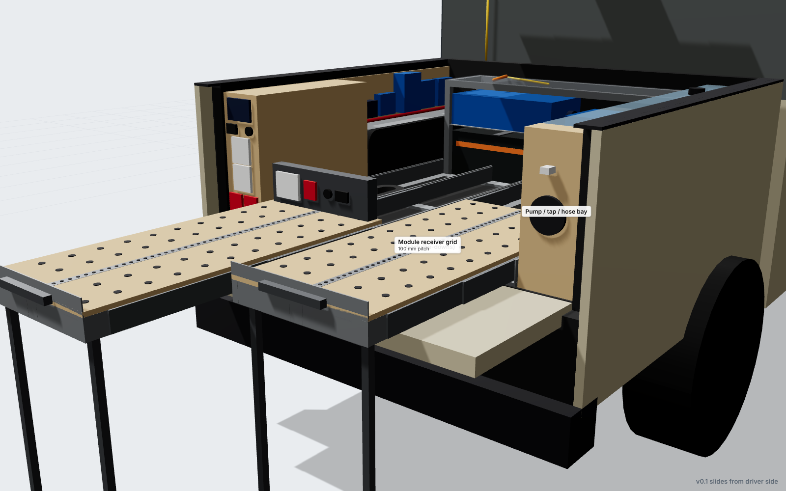
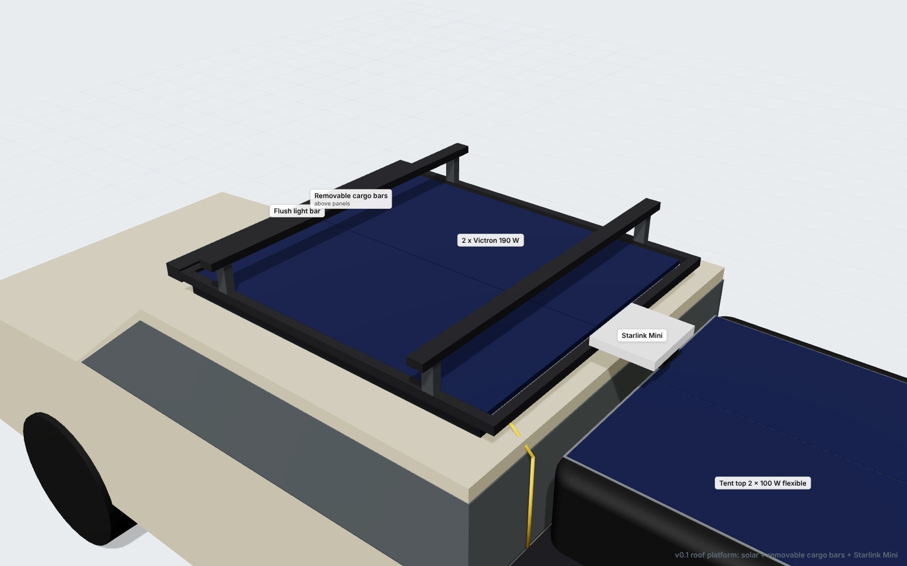

# Kia Tasman X-Pro fit-out

DIY tub, electrical and roof fit-out for a Kia Tasman X-Pro dual cab with a Ute Master Load-Lid and a 23Zero Panther Horizon 1600 rooftop tent.

**Current version: v0.1 (quick concept for feedback).** See [`docs/v0.1-concept.md`](docs/v0.1-concept.md).



| | |
|---|---|
|  |  |
|  |  |
|  |  |

## Repository layout

| Path | What |
|---|---|
| `docs/design-brief.md` | Requirements and decision log |
| `docs/v0.1-concept.md` | Current concept: layout, electrical block diagram, weight budget, open questions |
| `docs/research-notes.md` | Sourced dimensions and specs for every component |
| `cad/params.py` | **Every dimension in one place**, each flagged `[PUB]` published, `[EST]` estimate (measure!), or `[DES]` design choice |
| `cad/model.py` | Parametric CadQuery model |
| `cad/build.py` | Exports `viewer/models/*.glb` (viewer), `cad/out/fitout_fab.step` (fabricated parts) and `cad/out/summary.json` |
| `cad/out/fitout_fab.step` | STEP file of all fabricated parts. Opens in Fusion 360, FreeCAD (free), Onshape (free, browser) |
| `viewer/index.html` | Interactive 3D viewer (three.js): orbit, toggle layers, camp/travel states |
| `renders/<version>/` | Rendered images per version |
| `bom/` | Product list (cutting list follows once the layout is frozen) |
| `reference/` | Owner photos and the 23Zero tent drawing |

## Viewing the model

- **Easiest:** open the STEP file in [Onshape](https://www.onshape.com) or [FreeCAD](https://www.freecad.org) (both free).
- **Interactive viewer:** run `npx serve viewer` (or `python3 -m http.server -d viewer`) and open the URL it prints.

## Rebuilding

```bash
python3 -m venv .venv && .venv/bin/pip install -r cad/requirements.txt
cd cad && ../.venv/bin/python build.py              # model -> GLB + STEP + summary
cd ../tools/render && npm install && node render.mjs shots_v0.1.json ../../renders/v0.1
```

Change a number in `cad/params.py`, rebuild and re-render. Every part follows.

## Coordinate system (tub frame)

`X` runs rearward from the inner face of the tub front wall. `Y` is across the tub (+ = driver/right, − = passenger/left). `Z` is up from the tub floor. Units are mm.

## Safety notes

- Fixed 240 V wiring in a vehicle must be installed or certified by a licensed electrician (AS/NZS 3001.2), with an RCD on every inverter circuit.
- Check GVM (3250 kg), roof (100 kg dynamic) and Load-Lid (200 kg dynamic) limits. See the weight budget in the concept doc.
