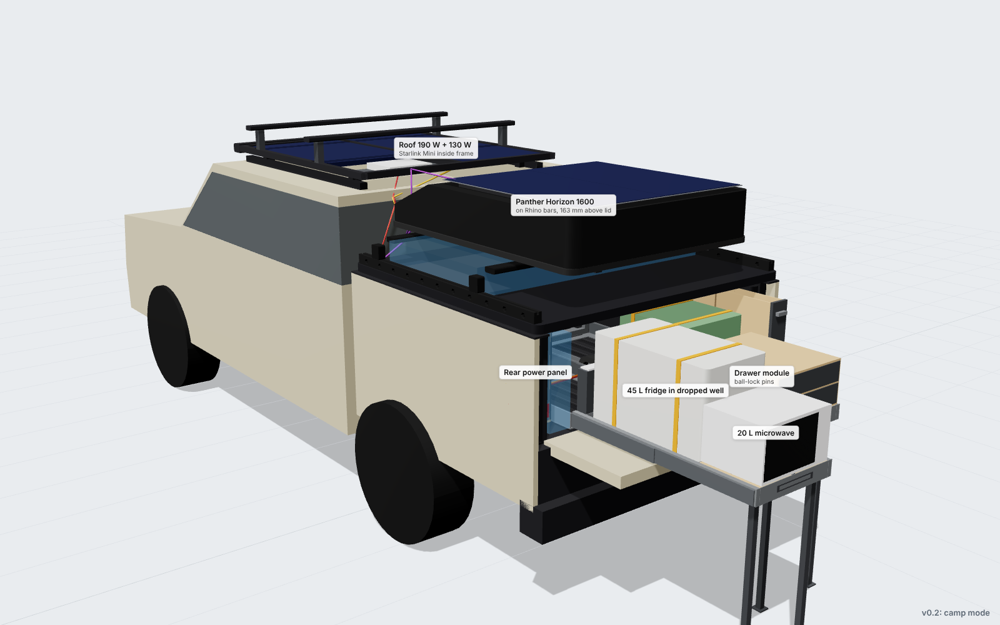
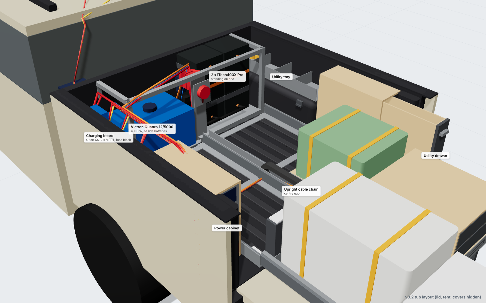
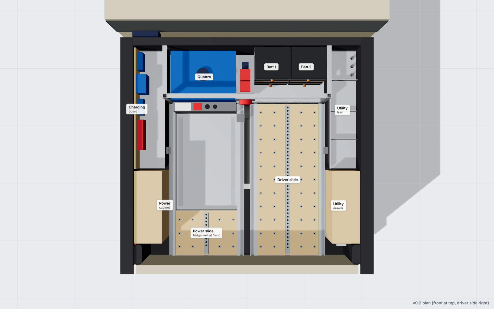
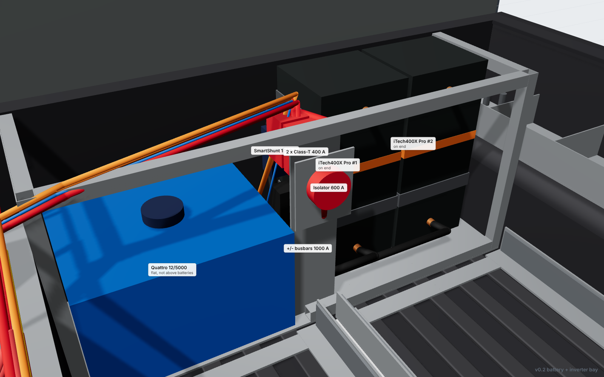
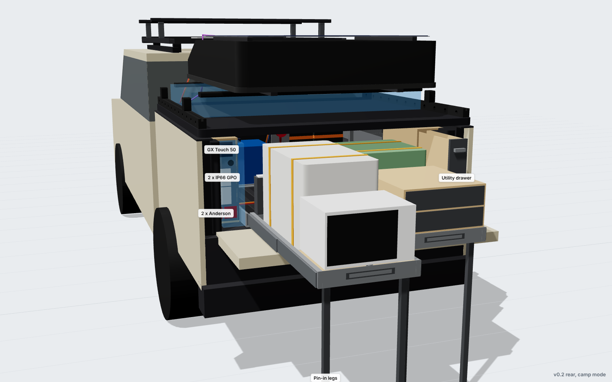
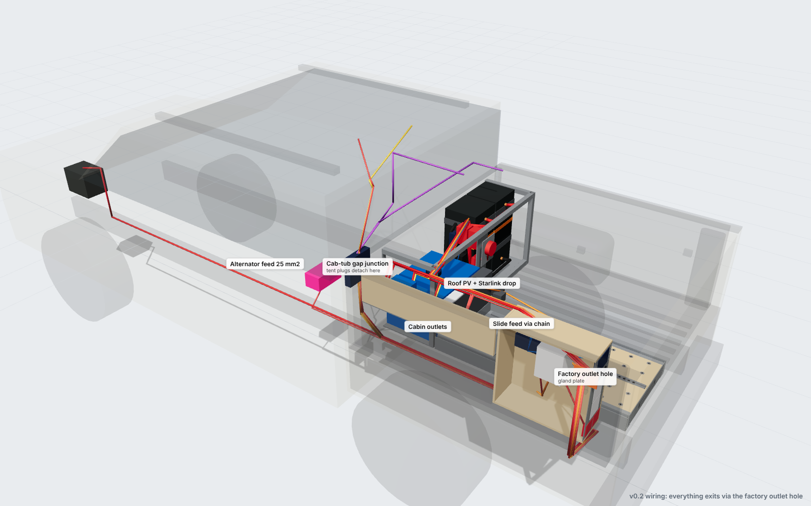
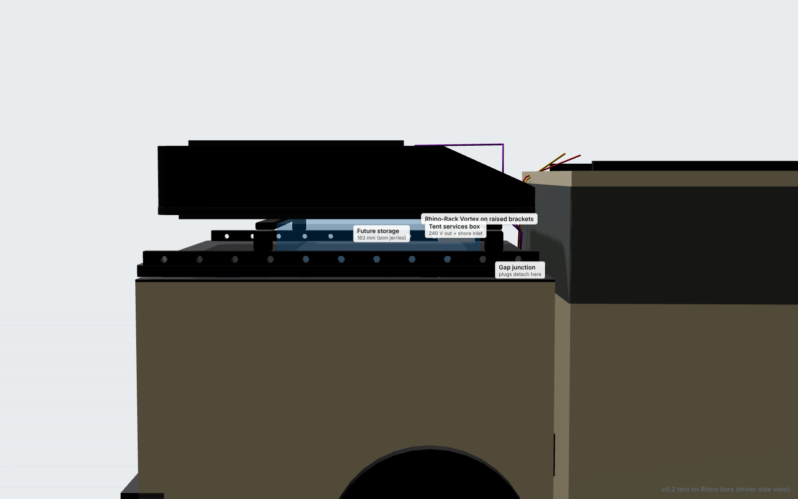
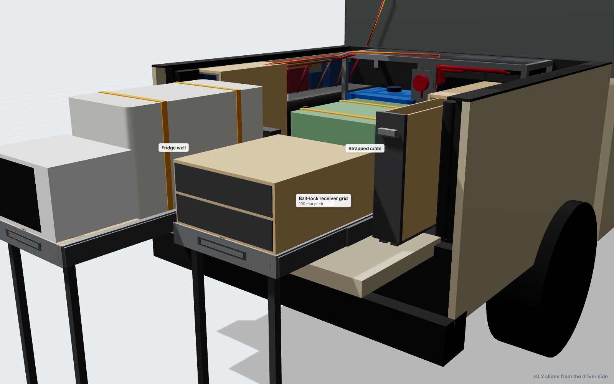
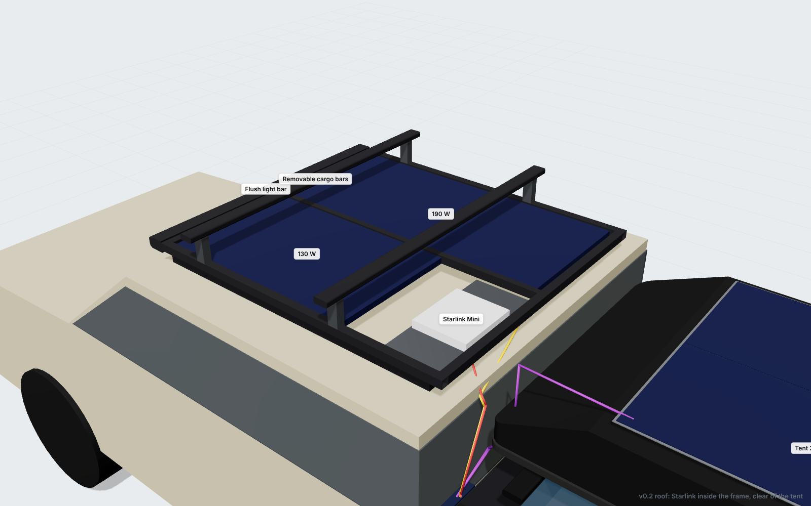

# Kia Tasman X-Pro fit-out

DIY tub, electrical and roof fit-out for a Kia Tasman X-Pro dual cab with a Ute Master Load-Lid and a 23Zero Panther Horizon 1600 rooftop tent (on Rhino-Rack bars).

**Current version: v0.2.** See [`docs/v0.2-concept.md`](docs/v0.2-concept.md). The previous version is in [`docs/v0.1-concept.md`](docs/v0.1-concept.md), and [`docs/weight-options.md`](docs/weight-options.md) covers weight trade-offs.



| | |
|---|---|
|  |  |
|  |  |
|  |  |
|  |  |

## Repository layout

| Path | What |
|---|---|
| `docs/design-brief.md` | Requirements and decision log |
| `docs/v0.2-concept.md` | Current concept: changes, layout, slide proposal, electrical diagram, weight and axle loads, measurements needed |
| `docs/research-notes.md` | Sourced dimensions and specs |
| `cad/params.py` | **Every dimension in one place.** Each is flagged `[PUB]` (published), `[EST]` (estimate, measure it), `[DES]` (design choice) or `[CONFIRM]` |
| `cad/fitout/` | Parametric CadQuery model, one module per subsystem: `vehicle`, `lid_tent`, `bay`, `slides`, `side_bays`, `roof`, `modules` (example payload), `wiring` (routed cables + schedule) |
| `cad/build.py` | Builds both states. Exports the GLB viewer models, `cad/out/fitout_fab.step` and `cad/out/summary.json`, and generates the BOM CSVs |
| `cad/clash.py` | Interference check between all solid parts (travel + camp states) |
| `bom/weight-budget-<ver>.csv` | Mass of every part (fit-out vs example payload) |
| `bom/cut-list-<ver>.csv` | Fabricated parts grouped by material and cut size (preliminary) |
| `bom/cable-schedule-<ver>.csv` | Every cable: from/to, size, protection, **length measured along its modelled route** |
| `bom/cable-totals-<ver>.csv` | Cable purchase quantities |
| `bom/product-list-<ver>.csv` | Purchased components |
| `viewer/index.html` | Interactive 3D viewer (three.js): orbit, toggle layers, camp/travel states, preset views |
| `renders/<version>/` | Rendered images per version |
| `reference/` | Owner photos and the 23Zero tent drawing |

## Viewing the model

- **STEP:** open `cad/out/fitout_fab.step` in [Onshape](https://www.onshape.com) or [FreeCAD](https://www.freecad.org) (both free).
- **Interactive viewer (artifact):** `python3 tools/make_artifact.py <dir>` packages the viewer as a self-contained page.
- **Interactive viewer (local):** run `npx serve viewer` (or `python3 -m http.server -d viewer`) and open the URL it prints.

## Rebuilding

```bash
python3 -m venv .venv && .venv/bin/pip install -r cad/requirements.txt
cd cad && ../.venv/bin/python build.py      # model -> GLB + STEP + summary + BOM CSVs
../.venv/bin/python clash.py                 # interference check
cd ../tools/render && npm install && node render.mjs shots_v0.2.json ../../renders/v0.2
```

Change a number in `cad/params.py`, rebuild, re-check and re-render. Every part, cable length and weight follows.

## Coordinate system (tub frame)

`X` runs rearward from the inner face of the tub front wall. `Y` is across the tub (+ = driver/right, − = passenger/left). `Z` is up from the tops of the floor liner ribs. Units are mm.

## Safety notes

- Fixed 240 V wiring in a vehicle must be installed or certified by a licensed electrician (AS/NZS 3001.2), with an RCD/RCBO on every inverter circuit.
- Check the limits: GVM 3250 kg (payload 1013), **rear axle 2002 kg**, roof 100 kg dynamic, Load-Lid 200 kg dynamic. The open tailgate has no published rating. See the weight and axle tables in the v0.2 concept.
