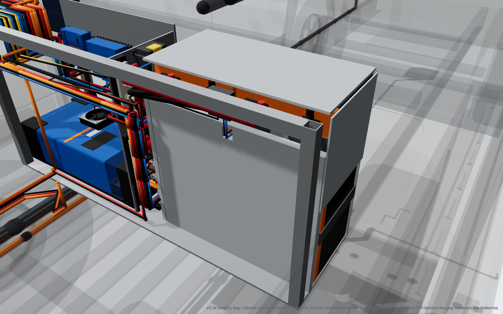
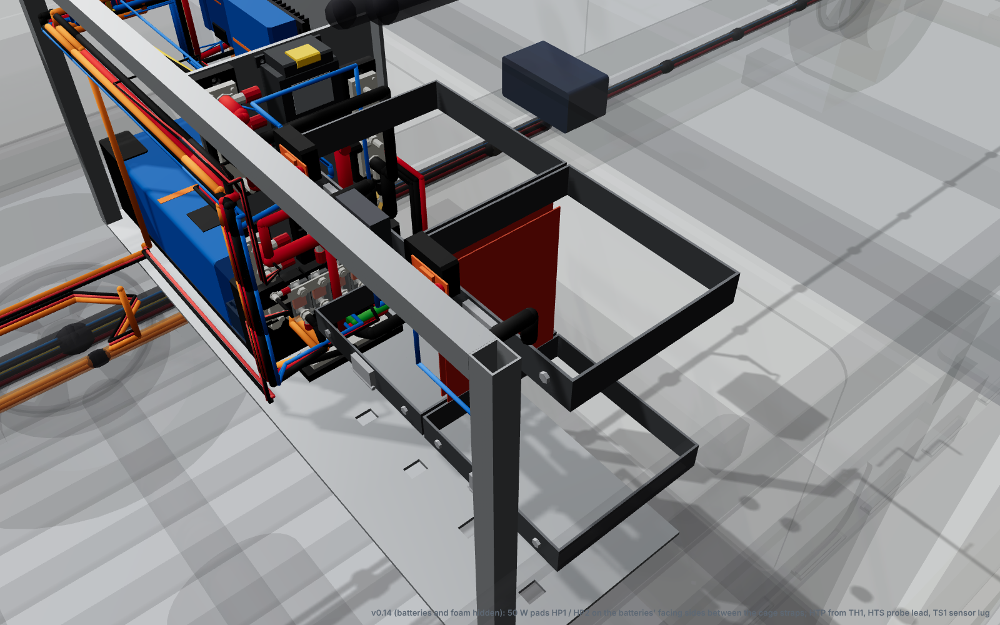
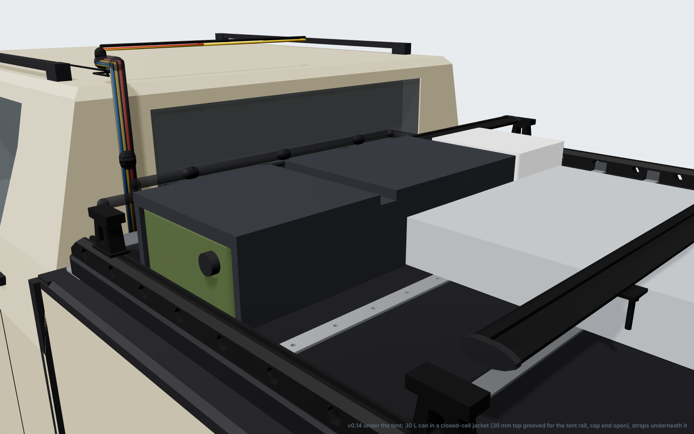
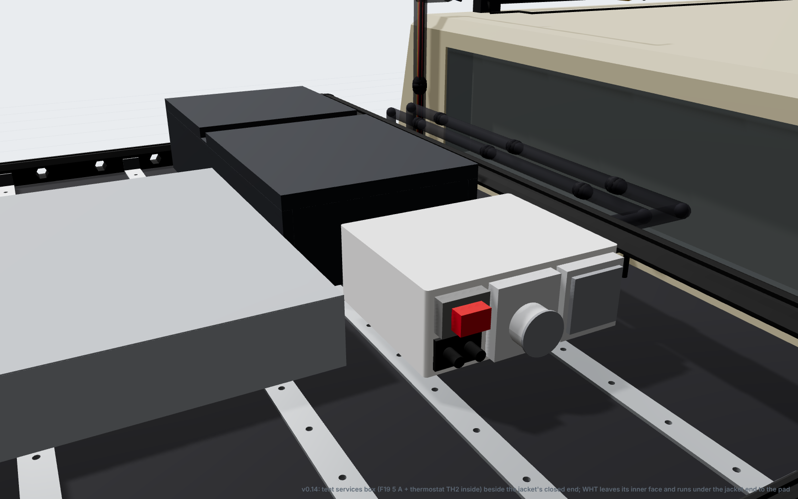

# v0.14 concept: cold-weather heating for the batteries and the water can

Status: **fourteenth iteration.**
- The part interference check reports **0** clashes in travel and camp, and so does the cable route check.
- Tub, cavity and chassis dimensions are still `[EST]` until the measurement sheet comes back.
- **Design and energy figures:** [`cold-weather.md`](cold-weather.md).
- **Wiring:** [`docs/wiring/`](wiring), new sheet **E16**.
- **Renders:** [`renders/v0.14/`](../renders/v0.14).

Owner request: snow camping in sub-zero temperatures. The batteries must not charge below 0 °C, and the water must not freeze.

## 1. Battery bay

| Part | Where (model, mm) | |
|---|---|---|
| Rear foam, 20 mm | x 242–262, behind the strap buckles, z 6–440 (below the terminals) | Notched at the gap between the batteries for the pad and probe leads |
| Inboard foam, 15 mm | y 70–85, between battery 1 and the riser | Clear of the busbars and the riser |
| Top foam, 6 mm | z 540–546, glued under the lid | Lugs at 539, lid at 548 |
| Front foam, 4 mm | x 1–5, against the front wall | |
| Outer foam, 4 mm | y 584–588, above the wheel arch only | 2 mm to the arch below z 292 |
| **HP1 / HP2**, 2 × 50 W | Facing sides of the batteries, x 20–195, z 200–416 (between the cage straps) | 50 °C NC cut-out bonded to each |
| **TH1** thermostat + relay | IP65 box on the rear foam's top edge, behind the gap (x 262–284, z 466–530) | On < +3 °C, off > +8 °C; probe on battery 2 |

## 2. Water can

| Part | Where | |
|---|---|---|
| Jacket top, 30 mm | Over the straps, 3 mm under the tent base | Grooved over the tent under-rail (y −420 to −380) |
| Jacket sides and end, 18–20 mm | Sides at x 220–240 and 580–598; closed end at y 75–95 | The front side is thinned to 8 mm at the tent mount clamp. The cap end is open. |
| **HP3**, 50 W | Under the can, between cross-bars 0 and 1, on a 3 mm foam strip | 45 °C cut-out |
| **TH2**, F19 5 A, plug XW | In the tent services box, on X5's 12 V | The pad lead unplugs with the tent |

## 3. Wiring changes

| Cable | What | Route |
|---|---|---|
| **TS1** (replaces SHV) | Victron temperature sensor: lug on battery 1's + post. Red goes to SmartShunt V+ (fused in the lead), black to Aux. | In the bay, local |
| **HTR** | 2.5 mm² twin, BB3 stud 4 → **F18 10 A** → TH1; − to BB4 | R01 riser, then behind the batteries, 0.9 m |
| **HTP** | 1.5 mm² silicone twin, TH1 → HP1 + HP2 | Through the foam notch, down the gap between the lids |
| **HTS** | TH1's NTC probe lead → battery 2's lid face, mid-height | Behind the rear foam |
| **WHT** | 1.5 mm² silicone twin: services box (**F19 5 A**, TH2) → plug XW → HP3 | On the lid top, under the jacket's closed end, 0.5 m |

**Sheet changes:**
- **E16** (new) has all three circuits: the battery heater, the water heater, and the temperature sense to every charger (low-temperature cut-off at +3 °C). It also has the settings and the one-off tests.
- **E2** gains the TS1 sensor and flags for the heater feed.
- **E7** gains the water-pad tap off X5.
- **E10 and E13** draw the new cables to scale.
- **E13's cable table** now fits the page. In v0.13 its columns ran off the edge.

The viewer has two new layers: *Battery insulation* and *Battery heaters*.

## 4. Numbers

| | v0.13 | v0.14 |
|---|---|---|
| Cables | 56, 162.1 m | **60, 164.7 m** (SHV out; TS1, HTR, HTP, HTS, WHT in) |
| Parts total | A$28,499 (after the iTech price correction) | **A$28,926**: battery kit +A$242 (stage 1), water kit +A$170 (stage 6), cable +A$15 |
| Fit-out mass | 547.8 kg | **549.6 kg** (foam, pads, jacket) |
| Overnight draw at −10 °C | 0 | **about 60 Ah** (the batteries about 43 Ah, the water about 15–20 Ah) **[est]** |
| Wiring sheets | 15 | **16** |
| Clashes / cable crossings | 0 / 0 | **0 / 0** |

## 5. What this needs from you

1. **Ask iTechworld:**
   - Does the BMS block charging below 0 °C, and at what temperature?
   - Is the case fine with a 50 °C pad bonded to it (0.13 W/cm²)?
2. **Measure** (new items on the measurement sheet):
   - **L13:** the lid underside over the batteries. The top foam assumes 9 mm above the handle lugs.
   - **L14:** the lid top to the tent base, and to the tent's under-rail, over the can. The model has the base 25 mm above the rail bottom, so a 30 mm jacket top fits. If the base is level with the rails, the top drops to about 5 mm and the water heat loss rises to about 3.5 W/K.
3. **After the Victron setup:** chill the TS1 lug and confirm every charger stops. In particular, check the Orion XS, which is on USB, not VE.Direct.
