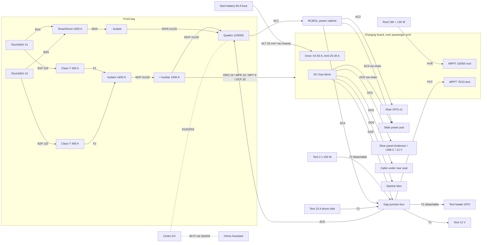

# v0.2 concept: higher-fidelity tub, wiring and tent interface

Status: **second iteration for feedback.**
- Every part is now built at real datasheet size, with a material and a mass.
- The build auto-generates the weight budget, axle loads, cutting list and cable schedule (`bom/*-v0.2.csv`).
- An interference check (`cad/clash.py`) reports **0 clashes** in both the travel and camp states.

Renders: [`renders/v0.2/`](../renders/v0.2). Interactive model: `viewer/` (see README).

## 1. What changed from v0.1

| Area | v0.1 | v0.2 | Why |
|---|---|---|---|
| Water | 88 L L-tank (driver side) | **Removed**, replaced by utility storage: rear pull-out drawer + over-arch tray with strap pegs | Freezing in winter; weight |
| Inverter | MultiPlus-II 12/3000 (2400 W continuous) | **Victron Quattro 12/5000/220-100/100** (4000 W @ 25 °C, 3700 W @ 40 °C, 220 A charger, 2 AC inputs) | Need ≥ 3000 W continuous. The only 12 V Victron units that do it are the 5 kVA models, and the MultiPlus-II 12/5000 is 702 mm tall so it can't stand in the tub |
| Battery layout | Flat on the floor, inverter on a shelf above | **Both batteries stand on end**, Quattro lies flat beside them | Victron: the Quattro must not sit directly above batteries. iTechworld allows any orientation except upside down |
| DC protection | Lynx Class-T + Distributor | **2 × Class-T 400 A (one per battery)** + 1000 A busbars + MIDI fuses, isolator ≥ 600 A, SmartShunt 1000 A | Quattro 12/5000 needs 800 A total (2 × 400 A) and 2 × 120 mm² per pole |
| Alternator charging | 2 × Orion XS (100 A) | **1 × Orion XS 50 A, input limit set to 25–30 A to start** (adjustable 1–50 A) | Alternator rating unknown. The Orion caps alternator draw whatever the inverter is doing |
| Tent wiring | Through the load lid | **Nothing passes through the lid.** All cables leave via the factory outlet hole, run along the passenger chassis rail, and come up the cab–tub gap to a **junction box at the passenger front corner**, where the tent harness unplugs | Owner requirement |
| Tent mounting | Directly on the lid | **2 × Rhino-Rack Vortex bars on raised brackets on the Destroyer rails**, tent 163.4 mm above the lid (iPhone 17 Pro Max height). The gap is modelled as a future storage volume | Matches the vehicle |
| Tent power | Location TBC | **Services box under the tent base, between the bars, toward the front, inset 170 mm from the fold-out side**: 240 V GPO (heater) + 15 A shore inlet | Sheltered by the tent floor; detaches with the tent |
| Starlink | Hanging off the rear of the platform | **Inside the platform frame** (passenger rear pocket). Panels are now 190 W + 130 W | The tent opens sideways and its raised shell needs that space |
| Slides | 4 runners each, deck at 98 mm | Proposal below: **2 locking runners each**, deck at **84 mm** (464 mm clear), **dropped fridge well** on the power slide (536 mm clear) | Lighter, and a 45 L fridge fits |
| Cable management | Lay-flat chain under the slide | **Upright igus chain in a 50 mm centre gap** between the slides | Frees the floor for the fridge well |
| Slide outlets | Rear-facing bulkhead | **Power pod with up-facing sockets** at the front of the power slide | Plugs can't foul the fridge |
| Rear power panel | Flush with the tub end | **Recessed 146 mm** (in front of the tail-light bulge) | Plugs stay inside with the tailgate shut |
| Modules | Concept | **8 mm push-button ball-lock pins** into flanged stainless receivers on a 100 mm grid (56 receivers) | Owner choice |

## 2. Tub layout (plan, front at top, driver side right)

```
                         FRONT WALL (cab)
 ┌───────────┬───────────────────────────────────────────┬───────────┐
 │ CHARGING  │ QUATTRO 12/5000 │DIST│ BATT 1  │ BATT 2   │ UTILITY   │
 │ BOARD     │ flat, fan above │Cl-T│ on end  │ on end   │ TRAY      │
 │ (over     │ 470 x 350 x 280 │bus │ 525 tall│ 525 tall │ (over     │
 │  arch)    ├─────────────────┴────┴─────────┴──────────┤  arch)    │
 │ Orion XS  │ POWER SLIDE      ┃chain┃  DRIVER SLIDE    │ straps,   │
 │ MPPT x2   │ pod ▲ sockets up ┃ 50  ┃  L-track + 44    │ shackles  │
 │ fuse blk  │ FRIDGE WELL      ┃ gap ┃  receivers       │           │
 ├───────────┤ (pan at 12 mm)   ┃     ┃                  ├───────────┤
 │ POWER     │                  ┃     ┃                  │ UTILITY   │
 │ CABINET   │ microwave (rear) ┃     ┃                  │ DRAWER    │
 │ Cerbo,RCBO│                  ┃     ┃                  │ (pulls    │
 │ panel ▼   │                  ┃     ┃                  │  rearward)│
 └───────────┴──────────────────┸─────┸──────────────────┴───────────┘
                          TAILGATE
```

## 3. Slides: the weight vs height trade-off (proposal)

**Deck height is set by the runner, not by how many runners there are.** Heavy-duty locking runners are 76.2 mm tall. With a 6 mm base and the ply recessed flush into the frame, the deck sits at **84 mm**, giving **464 mm** to the underside of the lid. Fewer runners save weight but don't lower the deck.

**Proposal:**
- **Both slides: one pair of Accuride DZ9308 (lock in and lock out), 44" / 1118 mm, 100 % extension.**
  - Rated 218 kg per pair in moderate use at full extension. I estimate about 120 kg in vehicle use (Accuride's vehicle rating is derived at a shorter length).
  - Saves about 13 kg against v0.1's 4-runner power slide.
  - A keel pair would block the fridge well anyway.
- **Stowed:** each carriage rests on UHMW stops at the rear of the cassette, so road shock bypasses the runners.
- **Extended, heavy use:** two **pin-in legs** at the rear (stored in the utility drawer when travelling).
- **Power slide fridge well:** a folded 3 mm pan drops the fridge floor to 12 mm, leaving **536 mm** clear.
  - That fits 45 L-class fridges (most are 475–480 mm tall: Dometic CFX3 45 476 mm, CFF 45 475 mm) that **won't** fit on a flat 84 mm deck.
  - Length budget: pod 70 + well 728 + microwave 332 = 1130 of 1134 mm. **The fridge must be ≤ 718 mm long and the microwave ≤ 332 mm deep.**
- **On the tailgate:** Kia publishes **no load rating** for the open tailgate. It hangs on steel cables, and Carsales found strap loads distorting the Tasman tub enough that the tailgate fouled.
  - I've therefore **not designed the slides to rely on the tailgate**. The legs do that job.
  - If you want, low-friction UHMW skid pads under the carriage can rest on the tailgate for light assistance. Just don't stand on the slide or load it past the runner rating counting on the tailgate.

**What you can carry (lighter option, per slide):**

| | Power slide | Driver slide |
|---|---|---|
| Rated (est. in vehicle / full extension) | ~120 kg / ~218 kg | ~120 kg / ~218 kg |
| Example load modelled | 45 L fridge loaded 55 kg + 20 L microwave 11 kg + strap/pin hardware ≈ **70 kg** | 2-drawer module (cooking kit) 18 kg + dry-food crate 22 kg + extras ≈ **45 kg** (room for ~60 kg more: clothes bags, chairs, recovery kit) |
| Usable height | 536 mm in the well, 464 mm on the deck | 464 mm |
| Typical use | Fridge, microwave, kettle on a small pinned shelf | Kitchen drawers, food, clothes, camp table |

If you want more margin on either slide, a second runner pair can go back on the driver slide (no well there) for about +7 kg, raising its rating to about 240 kg in-vehicle.

## 4. Electrical system v0.2



The full cable list is in [`bom/cable-schedule-v0.2.csv`](../bom/cable-schedule-v0.2.csv): 32 cables, about 78 m modelled. Each row gives from/to, size, protection and **length measured along the modelled route** (+10 % slack, +0.3 m for terminations). Purchase quantities per cable type are in `bom/cable-totals-v0.2.csv`.

- **Single exit point:** every cable that leaves the tub goes through the **factory 240 V outlet hole**. That's the alternator feed, cabin outlets, Starlink, roof PV, and the tent circuits (12 V, PV, 240 V out, 240 V in). The factory outlet is removed and replaced by a gland plate (or a split cable-entry frame) inside the power cabinet. Outside, the cables follow the passenger chassis rail and branch to:
  - the engine bay (alternator feed)
  - a floor grommet under the rear seat (cabin outlets)
  - the cab–tub gap junction (tent and roof circuits)
- **Gap junction:** an IP66 box at the passenger front corner of the tub, between cab and tub. The tent harness (T1/T2) drops from the front of the tent and plugs into:
  - IP66 inline 240 V plug/socket × 2 (heater out, shore in)
  - Anderson SB50 × 2 (tent 12 V, tent PV)

  **Removing the tent = 4 plugs + 4 bar clamps.** The cab–tub gap isn't published (typically 20–40 mm), so measure it. If it's tight, the box moves outboard behind the cab's rear corner.
- **Alternator:** a single Orion XS with its input current limit at 25–30 A (about 0.4 kW from the alternator) until you know the alternator rating. The cable is 25 mm² so you can raise the limit to 50 A later without rewiring. Because the Orion is the only path from the alternator, using the inverter while driving can't overload the alternator; the batteries cover the difference.
- **Quattro idle draw:** 30 W no-load (AES 20 W, search mode 10 W), which is about 60 Ah/day if left on.
  - Use search mode, or have Home Assistant switch it off when no AC load is expected (the core *Victron GX* integration exposes inverter mode).
  - Kettle + microwave together (about 3.4 kW) is now within rating.
- **240 V compliance:** an RCBO per circuit (rear GPOs, slide, tent). The Quattro's ground relay provides the neutral–earth bond in inverter mode. **A licensed electrician installs or certifies the 240 V side** (AS/NZS 3001.2).

## 5. Weight and axle loads (from the model)

| | kg |
|---|---|
| Fit-out (incl. existing lid 68, tent 84, Rhino bars 14, roof platform, roof solar, Starlink, cargo bars ~63) | **477** |
| Example payload (45 L fridge loaded, microwave, drawer module, crate) | 108 |
| 4 adults, bull bar (est 75), tow bar (est 30) | 425 |
| **Total vs 1013 kg payload** | **1010, so about 3 kg margin before luggage** |

| Axle | Added kg (model, driving) | Rating |
|---|---|---|
| Front | +280 | GAWR 1450 (kerb share unknown) |
| Rear | +706 | **GAWR 2002 kg (X-Pro)** |

- **With four adults you're at the GVM with no luggage.** With two adults you have about 160 kg for luggage and water.
- The rear axle needs its kerb share measured. At a typical ~1000 kg kerb rear, +706 kg leaves ~300 kg.
- The biggest remaining levers:
  - leave the tent off between trips (−84)
  - the roof platform and its solar (−63)
  - the second battery (−38)
- **Weigh the finished ute per axle.**

## 6. Measurements I need from you (all flagged `[EST]` in `cad/params.py`)

1. Wheel-arch length from the front wall, and arch height (currently 860 / 290).
2. **Tail-light bulge** at the rear corners: does it exist inside the tub, and how far does it protrude? (Currently 140 × 60. It sets the utility drawer width and the recessed panel.)
3. Cab–tub gap at the passenger front corner.
4. Underside of the closed lid to the tub floor (sets the 548 mm ceiling; the batteries on end leave 17 mm).
5. Tent: which side folds out (assumed **driver side**), which end is sloped (assumed front), and the Rhino bar positions.
6. Factory outlet position (X along the wall, height).
7. Tub rib pitch and height, and the bed hook positions.

## 7. Questions for v0.3

1. Is the tent fold-out on the driver or passenger side? Is the services-box position (front, between the bars, 170 mm in from the fold-out edge) right?
2. Happy with the **2-runner + fridge well** proposal? Any fridge you're leaning toward? It needs to be ≤ 718 mm long and ≤ ~520 mm tall.
3. Quattro 12/5000 (34 kg, $3.9k ex GST) is the only Victron that meets ≥ 3000 W. Accept it, or trade down to 2400 W (MultiPlus-II 12/3000) to save 15 kg?
4. Utility drawer: keep a rear pull-out (narrowed by the bulge) or go to a lid-access tub with a rear hatch?
5. Anything specific for the under-tent gap storage when you measure it? Front Runner's 40 L flat water tank (1260 × 550 × 65) and RotopaX packs (76 mm) both fit 163 mm.
