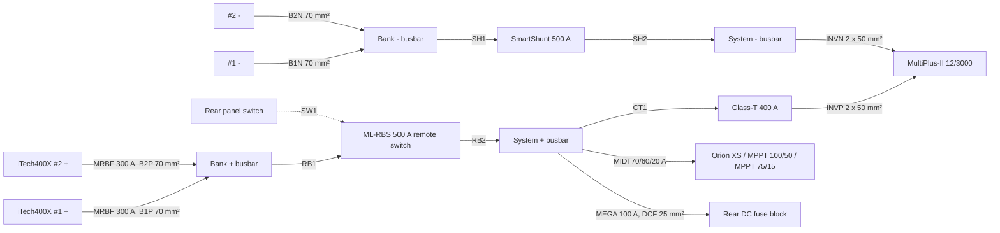

# v0.3 concept: MultiPlus-II, everything reachable from the tailgate

Status: **third iteration for feedback.**
- Generated outputs are in `bom/*-v0.3.csv`.
- The interference check reports **0 clashes** in both the travel and camp states.
- Measurements are still the `[EST]` values in `cad/params.py`, to be replaced when you measure.

Renders: [`renders/v0.3/`](../renders/v0.3). Empty-slide renders: `02_hero_camp_empty`, `05_tub_iso_empty`, `11_slides_empty`.

## 1. What changed from v0.2

| Area | v0.2 | v0.3 | Why |
|---|---|---|---|
| Inverter | Quattro 12/5000 (4000 W, 34 kg) | **Victron MultiPlus-II 12/3000/120-32**: 2400 W @ 25 °C (2200 W @ 40 °C), 5500 W peak, 120 A charger, 32 A transfer switch, 20 kg | 2400 W is enough. **Kettle *or* microwave, not both** |
| Bay | 360 mm deep | **320 mm deep** | Smaller inverter |
| Slides | 1134 mm long, 44" runners | **1174 mm, 46" DZ9308 runners (1168 mm travel)** | Bay got shallower |
| Fridge well | ≤ 718 mm fridge | **≤ ~756 mm fridge** (well 766 mm) | Longer slide; most 45–55 L fridges fit |
| Battery protection | 2 × Class-T, 2 × 120 mm² | **MRBF 300 A per battery, 1 × Class-T 400 A on the inverter feed, 70 mm² bank cables, 2 × 50 mm² inverter cables**, SmartShunt 500 A | Sized for the MultiPlus-II per Victron |
| Isolator | Manual 600 A switch on the bay rear face | **Blue Sea ML-RBS 500 A remote battery switch** in the bay, **switched from the rear panel** (manual override knob on the unit) | Lid can't open; the isolator must be reachable from the tailgate without dragging heavy cables to the back |
| Charging board | Over the passenger arch | **On the front wall above the inverter** (≈140 mm air gap) | Frees the over-arch space for slide-out storage; shorter cables |
| Over-arch space | Charging board / lid-access tray | **Full-length upper drawers on both sides** (1.4 m long, pull out the back on 48" runners) | Lid can't be opened with the tent on |
| Passenger rear pocket | Full-height power cabinet | **Lower control cabinet** (floor to arch height) under the upper drawer. Its rear face is a **hinged control panel**; RCBOs, DC fuse block and Cerbo GX sit behind it | All switching and fuses reachable from the tailgate |
| Driver rear pocket | Narrow drawer (cleared a tail-light bulge) | **Full-width lower utility drawer** (no bulge), plus the upper drawer above | Owner: no bulge |
| Cable route in the tub | Over the arch, inside the furniture | **Cable tray along the passenger wall above the upper drawer**, plus a 22 mm channel behind that drawer down to the gland and the control cabinet | Keeps the drawers clear |

## 2. Layout (plan, front at top, driver side right)

```
                          FRONT WALL (cab)
 ┌───────────┬──────────────────────────────────────────┬───────────┐
 │           │ MultiPlus-II flat│DIST│ BATT 1  │ BATT 2   │           │
 │  UPPER    │ + charging board │MRBF│ on end  │ on end   │  UPPER    │
 │  DRAWER   │   on front wall  │RBS │         │          │  DRAWER   │
 │ (over the │──────────────────┴────┴─────────┴──────────│ (over the │
 │  arch,    │ POWER SLIDE      ┃chain┃  DRIVER SLIDE     │  arch,    │
 │  full     │ pod ▲  FRIDGE    ┃ gap ┃  L-track +        │  full     │
 │  length,  │ WELL (≤756 mm)   ┃     ┃  receiver grid    │  length,  │
 │  slides   │                  ┃     ┃                   │  slides   │
 │  out the  │──────────        ┃     ┃                   │  out the  │
 │  back)    │ microwave (rear) ┃     ┃                   │  back)    │
 │───────────│                  ┃     ┃                   │───────────│
 │ CONTROL   │                  ┃     ┃                   │ LOWER     │
 │ CABINET ▼ │                  ┃     ┃                   │ UTILITY ▼ │
 └───────────┴──────────────────┸─────┸───────────────────┴───────────┘
                           TAILGATE (everything opens from here)
```

Upper drawers sit above the arch height (290–510 mm). The lower units sit below them, behind the arches. Usable drawer widths: passenger upper ~124 mm (it gives up 22 mm to the cable channel), driver upper ~146 mm, lower utility drawer ~155 mm.

## 3. Optimal battery configuration (2 × iTech400X Pro, 800 Ah)



Why this is the optimal layout for this tub:
- **Batteries on end, inverter flat beside them.** The bay is 320 mm deep, the shallowest of every arrangement tried. Victron doesn't allow the inverter above the batteries. Lying both batteries flat side by side would need 1050 mm of width and leave nowhere for the inverter, and stacking them would hide the lower battery's terminals. On end, the terminals face the slides, so you can reach them by sliding the slides out.
- **Each battery has its own fuse** (MRBF 300 A on its + terminal, under its 250 A continuous rating). **Battery-to-busbar cables are cut to identical length** (B1P = B2P, B1N = B2N) so the two batteries share load and charge evenly. **Balance-charge each battery fully before connecting them in parallel**, and use the same settings for both: 14.4 V absorption, 13.5 V float.
- **The inverter is protected by its own 400 A Class-T** with 2 × 50 mm² per pole, per Victron's MultiPlus-II 12/3000 table. Everything else hangs off MIDI/MEGA fuses on the system busbar.
- **A remote battery switch (ML-RBS) means the heavy 70 mm² cables stay short in the bay.** Only a thin control cable runs to the rear panel. The switch latches, so it draws nothing standby, and it has a manual knob.
- **Charging stays within limits:**
  - **Battery acceptance:** charge sources total 120 A (MultiPlus) + 25–30 A (Orion) + 65 A (two MPPTs, max) ≈ 215 A, within the 300 A the pair accepts.
  - **Alternator:** the Orion's limit caps alternator draw at about 0.4 kW, whatever the inverter is doing.
- **Living with 2400 W:**
  - A 2200 W kettle or a microwave (about 1150 W input) runs fine, **one at a time**.
  - Home Assistant can watch AC load through the Cerbo and switch off non-essential loads.
  - The MultiPlus-II idles at about 13 W (about 3 W in search mode).

## 4. Everything from the tailgate (lid stays shut)

| Task | How |
|---|---|
| Isolate the batteries | Rear panel **battery switch** (drives the ML-RBS). Manual override knob on the switch in the bay |
| Inverter on/off | Rear panel **inverter switch** (MultiPlus remote terminals). Mode and limits via GX Touch, VictronConnect or Home Assistant |
| AC protection | **RCBOs behind the hinged rear panel** |
| DC fuses (outlets, cabin, Starlink, tent 12 V) | **DC fuse block behind the hinged rear panel** |
| Monitoring | **GX Touch 50** on the rear panel. Cerbo GX behind it |
| Outlets | Rear panel: double GPO, 2 × Anderson, USB-C PD, 12 V. Power-slide pod: GPO, Anderson, 12 V, USB-C |
| Storage | Upper drawers (both sides) and lower utility drawer pull out the back. Slides fully extend |
| Bank terminals, Class-T, MIDI fuses, chargers | Slide the slides out and reach into the bay (rare service). The bay rear face has a perforated guard |

The rear panel is **recessed 105 mm** from the tub end so plugs stay inside with the tailgate shut.

## 5. Slides (unchanged proposal, now longer)

- **Runners:** both slides use one pair of Accuride DZ9308 46" (lock in and lock out, 100 % extension), ~210 kg per pair in moderate use, estimated ~120 kg in-vehicle.
- **Deck:** 84 mm high, 464 mm clear to the lid.
- **Power slide:** fridge well (536 mm clear). Power pod at the front with up-facing sockets. Upright cable chain in the 50 mm centre gap.
- **Support:** pin-in legs for heavy use when extended. UHMW stops take road loads when stowed. Nothing relies on the tailgate.
- **Power slide length budget:** pod 70 + fridge well 766 + microwave ≤ 332 = 1174 mm.

## 6. Weight and axle loads (model)

| | kg |
|---|---|
| Fit-out (incl. lid 68, tent 84, Rhino bars 14, roof platform + roof solar + Starlink + cargo bars ~63) | **470** |
| Example payload (fridge loaded, microwave, drawer module, crate, straps) | 108 |
| 4 adults, bull bar (est 75), tow bar (est 30) | 425 |
| **Total vs 1013 kg payload** | **1003, so ~10 kg margin before luggage with four adults; ~170 kg with two** |

| Axle | Added (driving) | Rating |
|---|---|---|
| Front | ~+280 kg | 1450 kg GAWR |
| Rear | ~+705 kg | 2002 kg GAWR (kerb share still to be weighed) |

The MultiPlus-II saves 14 kg over the Quattro, but the new upper drawers and the control cabinet add back about 10 kg. The cable total is now ~86 m because the charging inputs run further to reach the front wall.

## 7. Still to measure (no change needed now)

1. Arch length and height (860 / 290).
2. Cab–tub gap at the passenger front corner.
3. Floor to the underside of the lid (548; batteries on end leave 17 mm).
4. Factory outlet position (X 1330, Z 400).
5. Rib pitch and the bed hook positions. The rear bed hooks end up behind the upper drawer panels and can serve as carcass anchors.

## 8. Questions for v0.4

1. The rear control panel is compact (193 × 278 mm). Are the battery switch, inverter switch, GX Touch, double GPO, 2 × Anderson, USB-C and 12 V the right set?
2. The upper drawers are narrow (124–146 mm) but 1.4 m long. Good for straps, recovery gear, awning/tent poles and tools. Do you want dividers fixed, or removable on the same ball-lock idea?
3. Should I start detailing the fabrication drawings (cassette, carriage, bay frame) with dimensions, hole positions and weld callouts next, or the full wiring diagram first?
